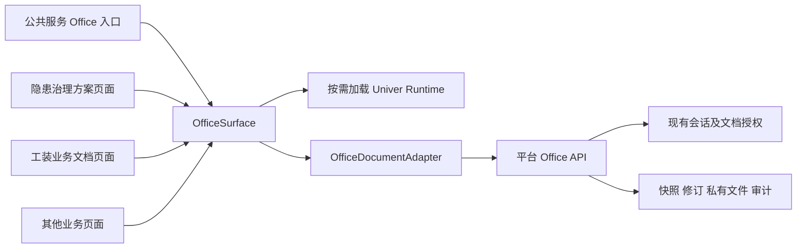

# Univer 公共 Office 能力接入方案

核对日期为 2026-11-19。本文依据用户的最新方向，将 Univer 嵌入前端，并放在公共服务部分供各业务使用。后端提供身份、文档授权、持久化、文件和审计配套。当前交付是调研、隔离兼容实验与可评审方案。

## 结论

可以把 Univer 作为前端公共 Office 编辑能力。建议第一阶段交付单人 Sheets 编辑器，业务通过统一组件和文档适配器加载、保存、引用内容。后续 Docs 先通过真实业务模板验证，再扩展同一公共入口。React 19.3.1 与官方 peer 范围相符，本次 Vite 8.3.5 / TypeScript 7.0.2 隔离实验已验证 Sheets 构建、中文页面、公式计算和 JSON 快照。Office 原文件导入导出、多人协作及 Slides 属于另一组 SDK 能力，需按对应许可和服务配置接入。[官方开源范围与快速开始](https://github.com/dream-num/univer/blob/v1.5.2/README.md) · [安装说明](https://docs.univer.ai/guides/sheets/getting-started/installation)

## 当前产品范围与许可

实际 npm `@univerjs/presets` 和 `@univerjs/preset-sheets-core` 最新版本均为 1.5.2，官方 Release 发布于 2026-11-16。当前官网文档会继续更新，实施时须按已安装版本核对 API。所有配套 `@univerjs/*` 与商业 `@univerjs-pro/*` 应使用同一匹配发行版本。[发布记录](https://github.com/dream-num/univer/releases/tag/v1.5.2) · [API 稳定策略](https://github.com/dream-num/univer/blob/v1.5.2/docs/API_STABILITY.md)

| 需要的能力 | 官方当前提供方式 | 对项目的意义 |
| --- | --- | --- |
| Sheets 编辑、公式、样式、筛选及数据模型 | Apache-2.0 开源 Web SDK，按插件或 preset 组合 | 可以从单人编辑和快照保存开始 |
| Docs 富文本、段落、列表、链接、评论等 | 开源 Web SDK 的 Docs 能力 | 先以实际业务文档验证排版和功能 |
| JSON 快照保存、重新加载 | `workbook.save()` 等 Facade API，应用负责存储 | Java 后端可以保存原生快照，无需先部署协作服务 |
| XLSX / DOCX / PPTX 等原文件转换 | 独立的 Exchange / `@univerjs-pro/exchange-node` | 原文件在线编辑需要导入、快照编辑和导出整条链路 |
| 多人编辑、OT、版本历史及同步 | Node.js Collaboration SDK，HTTP 与 WebSocket | 在公共编辑器后面增加协作配套服务 |
| Slides、Boards 和若干高级编辑插件 | 当前分别分发的商业能力 | 生产使用前确认许可和目标文档类型 |

以上范围以 [官方仓库说明](https://github.com/dream-num/univer/blob/v1.5.2/README.md)、[协作服务说明](https://docs.univer.ai/server/collaboration/overview) 和 [文件转换说明](https://docs.univer.ai/server/import-export/node) 为依据。开源仓库使用 [Apache-2.0](https://github.com/dream-num/univer/blob/v1.5.2/LICENSE)，商业模块依其单独许可。当前 Freemium 协作上限为一个节点、三个协作编辑连接，Exchange 每月前十次导出无水印，后续带水印，商业生产需有效 Business 或 Enterprise 许可。当前 Business 页面显示从每月 99 美元起，具体容量、域名及授权范围以采购时条款为准。[许可配置](https://docs.univer.ai/server/license) · [当前方案与计量规则](https://univer.ai/pricing/)

官方 Exchange 的输入包括 Sheet 的 `.xls/.xlsx/.xlsm/.csv/.tsv`、Doc 的 `.doc/.docx`、Slide 的多种 PowerPoint 格式，输出主要为 `.xlsx/.csv/.tsv`、`.docx`、`.pptx`。原文件转换可能丢弃不支持的元素，官网要求用实际文件验证公式、图表和布局。本项目应建立脱敏样本集，逐项验收业务模板。支持导入某扩展名的声明不能单独证明其中宏、嵌入对象和复杂版式的完整往返。[转换格式表](https://docs.univer.ai/server/import-export/node#supported-formats) · [官网兼容说明](https://univer.ai/pricing/)

## 前端公共服务结构

建议新增公共 `office` 能力模块，向业务导出 `OfficeSurface`、文档引用类型和持久化适配器接口。底层 Univer preset、插件、语言、主题、事件和实例清理集中在该模块内。业务页面可以在侧栏、全页或弹窗使用同一 `OfficeSurface`。公共服务菜单提供文档列表和独立打开入口，具体路由需在现有代码注册的应用导航约束内实现。



建议的公共边界如下，字段和端点属于待实施设计。`documentId` 是平台的文档 ID，`unitId` 只在 Office 实现内部映射。应用级文档修订与 Univer SDK 版本分别记录。

```ts
interface OfficeDocumentRef {
  documentId: string;
  applicationKey: string;
  resourceType: string;
  resourceId: string;
}
interface OfficeDocumentSnapshot {
  document: OfficeDocumentRef;
  kind: "sheet" | "doc";
  revision: number;
  sdkVersion: string;
  snapshotSchemaVersion: string;
  snapshot: unknown;
  canEdit: boolean;
}
interface OfficeDocumentAdapter {
  load(ref: OfficeDocumentRef, signal: AbortSignal): Promise<OfficeDocumentSnapshot>;
  save(input: {
    document: OfficeDocumentRef;
    expectedRevision: number;
    idempotencyKey: string;
    snapshot: unknown;
  }, signal: AbortSignal): Promise<OfficeDocumentSnapshot>;
}
```

业务应用传入文档引用和适配器，通过 `onSaved` 接收新修订，用于业务附件或提交记录。公共编辑器可以接收只读模式，但实际读写资格由服务端逐请求校验。业务自定义动作通过宿主回调进入现有命令入口。例如“提交治理方案”保存并绑定准确文档修订，再调用隐患业务命令，不能仅凭前端 Office 保存完成就推进审批。

公共模块通过动态导入加载 Univer，加载器只共享 SDK 代码。每个已挂载编辑器分别持有实例、文档和事件订阅。文档切换、离开页面或切换租户时，取消加载、清理监听并执行 `univer.dispose()`，避免旧会话的实例和数据进入新页面。异步响应要校验仍属于当前文档和身份。React StrictMode 的挂载与卸载也要通过同样验收。[官方生命周期说明](https://docs.univer.ai/guides/sheets/getting-started/lifecycle)

## 平台配套边界

当前 `ApplicationEntityAction` 和 `ApplicationContribution` 使用代码注册的应用、资源及动作，导航路径为 `apps/{appKey}/entities/{entityKey}`。建议把 Office 公共服务注册为独立应用资源，首版使用已有 `read/create/update` 动作表达文档加载、新建和保存，再通过文档的业务归属关系验证调用者能否操作关联记录。具体授权映射需要后端实现和测试。业务资源 ID、租户或浏览器宣称的 Office 用户信息都不能替代平台当前会话。

当前文件链具有私有存储与校验能力，但 `FindingEvidenceFileAccessPolicy` 关联隐患、证据集、证据所有人和已验证文件版本，`VerifiedStorageVersionReadPort` 的输入也是封存的证据快照。Office 应建立自身文档授权和版本记录，复用可适用的存储及校验机制，再把完成的文件版本交给相应业务域引用。已提交的证据引用应固定具体 Office 修订、导出文件版本和摘要，后续编辑形成新版本。项目现有实现位置如下。

- `backend/src/main/java/com/mightyoung/softwarefactory/files/FindingEvidenceFileAccessPolicy.java`
- `backend/src/main/java/com/mightyoung/softwarefactory/files/VerifiedStorageVersionReadPort.java`
- `backend/src/main/java/com/mightyoung/softwarefactory/files/LocalPrivateFileStorageAdapter.java`
- `backend/src/main/java/com/mightyoung/softwarefactory/authorization/ApplicationEntityAction.java`
- `backend/src/main/java/com/mightyoung/softwarefactory/applicationregistry/navigation/ApplicationContribution.java`

单人编辑首版可由现有 Java API 保存文档元数据、原生快照和修订，用 `expectedRevision` 与幂等键避免覆盖或重复保存。保存结果未知时保留原键与原快照，确认后才能形成新编辑命令。平台需要新增对应 Office API、数据模型和策略，这些能力在当前代码中尚未实现。

多人协作阶段保持相同公共前端入口，在其内部增加 Collaboration Client，并连接配套 Node.js 服务。官方协作 SDK 提供 Transport、Endpoint、Service、Database Adapter，身份、租户和权限由平台接入。读取快照、进入文档 Room、提交修改和创建/删除文档分别有授权边界。Office 服务应复用平台的文档策略，避免只在 WebSocket JOIN 时授权。当前官方 PostgreSQL Adapter 要求 PostgreSQL 13+，服务 Node.js 22+，官方示例工程为 Node.js 24+。服务可以使用独立数据库账号及 schema，平台仍管理业务对象和文档归属。[身份和授权](https://docs.univer.ai/server/collaboration/identity-and-authorization) · [数据库适配器](https://docs.univer.ai/server/collaboration/database-adapters) · [环境要求](https://docs.univer.ai/server/requirements)

需要原 Office 文件导入导出时，再为公共服务增加 Exchange 任务。前端通过平台鉴权的任务接口发起导入或导出，后端记录输入文件版本、目标文档修订、任务状态和输出文件。任务要核对当前用户、原文件访问资格和版本，下载按私有文件策略办理。转换与协作服务所需商业 License key 只由服务端持有，浏览器仅使用官方 Web SDK 所需的公开授权内容。[文件转换边界](https://docs.univer.ai/server/import-export/node) · [授权文件配置](https://docs.univer.ai/server/license)

## 实施顺序与验收

1. 先落公共服务的 Office 列表和一个 Sheets 编辑宿主，由两个业务页面引用同一文档组件。单人编辑、原生快照保存/重载、只读查看、权限撤销、原键恢复和卸载清理形成首个可交付结果。
2. 在同一公共接口内加入 Docs，使用治理方案、检查记录和说明文档样本验证段落、表格、图片、分页及中文输入。所需插件及功能按安装版本逐项确定。
3. 若实际需求包含上传并下载 XLSX/DOCX，评估 Exchange 的许可、文件兼容性与任务服务后接入，验证导入失败、配额耗尽、导出后下载失败及重复点击等行为。
4. 若确需多人同时编辑，增加 Collaboration SDK，在两个独立身份浏览器中验证修改同步、断线重连、撤权、只读、并发与重启恢复，再接历史和审计展示。

所有阶段都应验证跨租户和越权文档引用被拒绝，已提交业务记录绑定的修订可重现，未知保存结果保留原请求，导航可见性与后端授权一致。Office 编辑器独立懒加载并设置自身包体、内存及初始化时延预算，主业务入口继续执行现有 130 KiB JS / 12 KiB CSS 预算。各阶段交付条件按需要的编辑格式和交互分别验收。

## 本次验证证据

隔离实验目录为 `/private/tmp/univer-eval-20261119`，使用正式 npm 1.5.2 的 Sheets Core preset、React / React DOM 19.3.1、Vite 8.3.5 和 TypeScript 7.0.2，安装脚本禁用。整理依赖树后确认只有一份运行时核心实例，TypeScript 检查和生产构建通过。浏览器中文编辑器通过 API 写入“治具”、数量 2、单价 25，实际公式 `=B2*C2` 得到 50，快照保留中文、公式和计算值。刷新页面恢复后与卸载再挂载后，文档 ID、中文内容和计算结果均一致，页面无运行时错误，外部网络请求数为零。实际浏览器日志位于该目录的 `browser-summary.json`。

该样板的 JS 入口 gzip 为 1615317 字节，约 1.54 MiB，CSS gzip 为 17874 字节，约 17.5 KiB。包含额外异步语言资源的全部 JS 产物 gzip 约 2.55 MiB，不能把它等同于首屏传输。此测量只代表官方基础 preset 的最小组合，尚未加入项目页面或 Docs / 商业插件。包体证明了独立加载和预算测量的必要性，实际首屏时间与内存需要再以生产页面测量。

本次没有部署协作服务或 Exchange，没有连接项目业务数据库，也没有上传业务 Office 文件。真实双人协作、商业许可、文件往返保真及项目权限接入仍属于后续验收。
